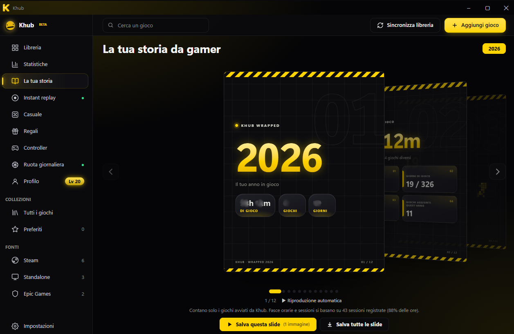
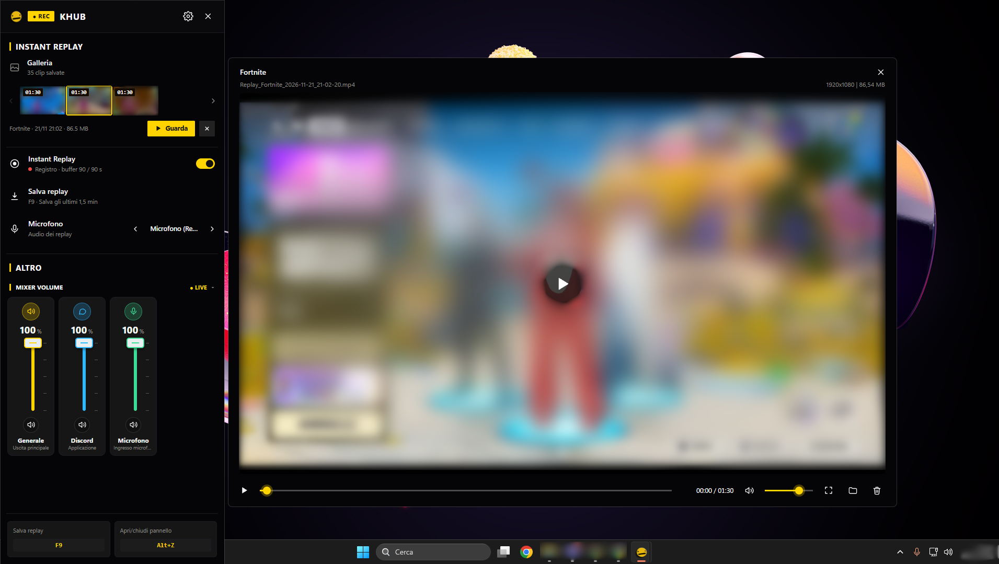
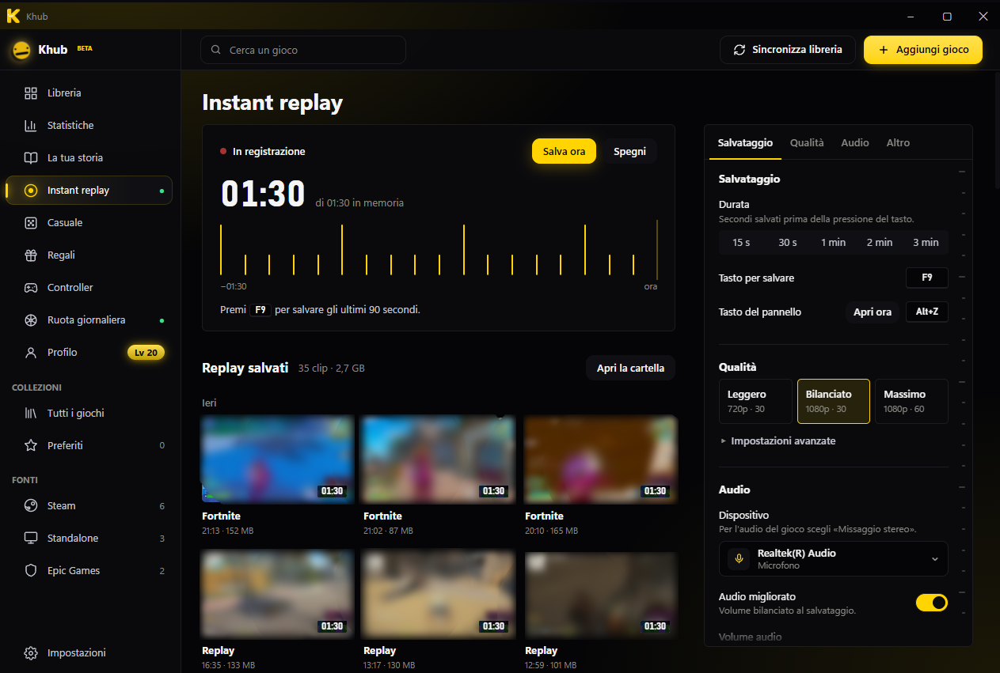
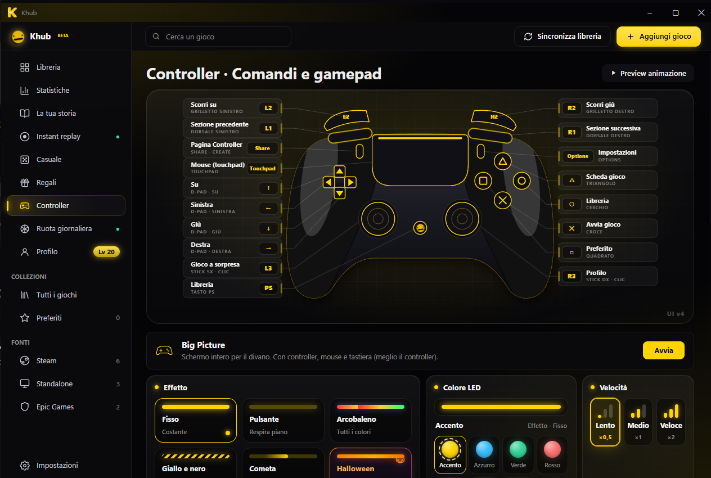

<!-- 📌 Metti il tuo logo in assets/logo.png (consigliato: 200x200, sfondo trasparente) -->

# Khub

### Tutti i tuoi giochi. Un unico launcher.

Libreria, statistiche, instant replay e controller in un'app veloce, elegante e **100% locale**.

 

[**Scarica**](https://github.com/K3KK09/Khub-web/releases) · [**Funzioni**](#-funzioni) · [**Installazione**](#-installazione) · [**FAQ**](#-domande-frequenti)

 

<!-- 📸 Screenshot principale: assets/screenshots/hero.png (consigliato: 1600x900) -->

 

## ✦ Cos'è Khub

**Khub** è un launcher personale per videogiochi. Invece di aprire Steam, Epic Games e decine di collegamenti diversi, apri Khub e trovi **tutto in un posto solo**: scegli un gioco, lo avvii, e Khub tiene il conto di quanto giochi.

Pensato per chi ha tanti giochi su piattaforme diverse e vuole **ordine, statistiche e un po' di divertimento in più**.

|  |  |  |
|:--:|:--:|:--:|
| 📚 **Una libreria**   Steam, Epic, Xbox, Ubisoft e `.exe` | 📊 **Statistiche**   Ore giocate, grafici e Wrapped | 🎬 **Instant Replay**   Salva gli ultimi secondi di gioco |

 

## ✦ Funzioni

### 📚 Libreria intelligente

Tutti i tuoi giochi, da ogni piattaforma, con copertine, ricerca istantanea, filtri per genere / piattaforma / stato / voto, e vista a griglia o a lista. La **sincronizzazione** trova da sola i giochi installati.

 

### 📊 Statistiche e Wrapped

Scopri quanto giochi davvero: grafici per giorno, settimana e mese, gioco del mese e dell'anno, confronto tra periodi e backlog. A fine anno ottieni il tuo **Gaming Wrapped**, in stile Spotify, da salvare e condividere.

<table>
<tr>
<td width="50%"></td>
<td width="50%"></td>
</tr>
<tr>
<td align="center">Statistiche avanzate</td>
<td align="center">Gaming Wrapped</td>
</tr>
</table>

 

### 🎬 Instant Replay

Con un solo tasto salvi **gli ultimi secondi di gioco**, come un replay istantaneo. Include mixer audio con riduzione del rumore del microfono e un lettore video integrato per rivedere le clip.

<table>
<tr>
<td width="46%" valign="top" align="center">

 <b>Pannello Instant Replay</b>
</td>
<td width="54%" valign="top" align="center">

 <b>Lettore video integrato</b>
  

<ul>
<li>⏺️ <b>Registrazione continua</b> in background, con buffer di 90 secondi</li>
<li>💾 <b>F9</b> salva gli ultimi secondi di gioco (tasto predefinito)</li>
<li>🪟 <b>Alt + Z</b> apre e chiude il pannello (tasto predefinito)</li>
<li>🎚️ <b>Mixer</b> separato per volume generale, Discord e microfono</li>
<li>🖼️ <b>Galleria</b> con tutte le clip salvate, pronte da guardare</li>
</ul>

 <b>Istant interface</b>
</td>
</tr>
</table>

 

### 🕹️ Controller e Big Picture

Usa Khub direttamente col **gamepad** (anche PS4 / PS5), comodo dal divano, con una modalità **Big Picture** a schermo intero pensata per il controller.

 

### ⚡ E non solo

<table>
<tr>
<td width="33%" valign="top">

**🎁 Profilo e livelli**
Guadagna XP giocando, sali di livello e sblocca colori, sfondi e il regalo giornaliero.

</td>
<td width="33%" valign="top">

**🎲 Consigli e casuale**
Non sai cosa giocare? Ricevi un suggerimento in base ai tuoi gusti, o lascia scegliere al caso.

</td>
<td width="33%" valign="top">

**🔊 Soundboard**
Fai partire suoni con una combinazione di tasti, ideale anche per le clip.

</td>
</tr>
<tr>
<td width="33%" valign="top">

**💬 Discord**
Mostra sul tuo profilo che stai usando Khub o a cosa stai giocando.

</td>
<td width="33%" valign="top">

**🆓 Giochi gratis**
Vedi i giochi gratuiti del momento su Epic Games.

</td>
<td width="33%" valign="top">

**🎨 Personalizzazione**
Colori, sfondi, temi e lingua (🇮🇹 Italiano / 🇬🇧 English).

</td>
</tr>
</table>

> 🔒 **Privacy:** i tuoi dati restano sul tuo PC. Khub non invia nulla online.

 

## ✦ Installazione

### Requisiti

- **Windows 10 / 11**
- Nessun altro programma da installare: **Python non serve**

### Come si scarica e si avvia

**1.** Vai nella sezione [**Releases**](https://github.com/K3KK09/Khub-web/releases) di questo repository.

**2.** Scarica il file **`Khub.exe`** dell'ultima versione.

**3.** Fai doppio clic su `Khub.exe`: Khub si apre subito.

> Alla prima apertura parte un **tutorial guidato** che ti mostra tutte le funzioni. 👋

<b>⚠️ Windows mostra «Windows ha protetto il PC»</b>

 

È un avviso normale per i programmi nuovi o non firmati. Clicca su **Ulteriori informazioni → Esegui comunque**.

 

## ✦ Dove vengono salvati i dati

Libreria, statistiche e impostazioni sono salvate in una cartella fissa sul tuo PC (file `game_hub_data.json`), quindi **non perdi nulla** anche se sposti o aggiorni `Khub.exe`.

 

## ✦ Domande frequenti

<b>Il programma non si apre</b>

 
Prova a scaricare di nuovo <code>Khub.exe</code> dalle Releases e a eseguirlo da una cartella normale (per esempio Documenti), non da dentro un file ZIP.

<b>L'Instant Replay non funziona</b>

 
Serve <b>ffmpeg</b>: Khub ti guida nell'installazione dalle Impostazioni.

<b>Su Discord non compare nulla</b>

 
Attiva «Condividi la mia attività» nelle impostazioni di Discord e in Khub.

<b>Come si aggiorna?</b>

 
Khub controlla da solo se è disponibile una nuova versione nelle Releases di GitHub e può aggiornarsi.

 

## ✦ Contribuire

Hai un'idea o hai trovato un bug? Apri una [**Issue**](https://github.com/K3KK09/Khub-web/issues): ogni segnalazione è benvenuta.

## ✦ Licenza

Distribuito con licenza **MIT**. <!-- ⚠️ Cambia se preferisci un'altra licenza e aggiungi il file LICENSE -->

 

**Fatto con ❤️ da [K3KK09](https://github.com/K3KK09)**

Se Khub ti piace, lascia una ⭐ al progetto!

