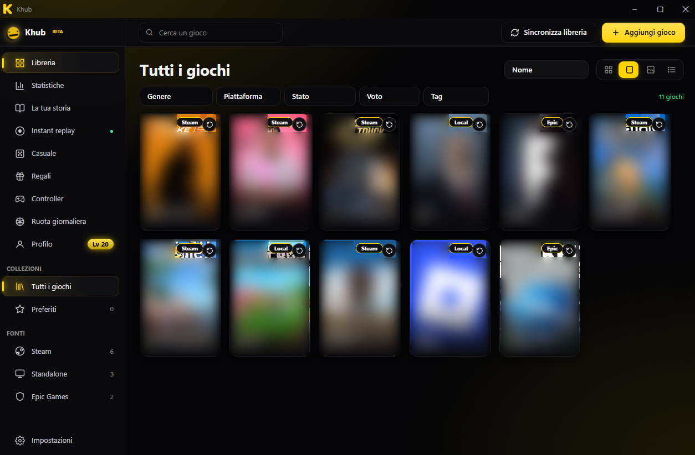
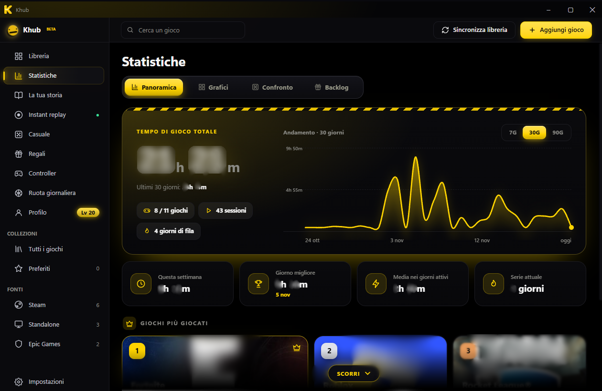
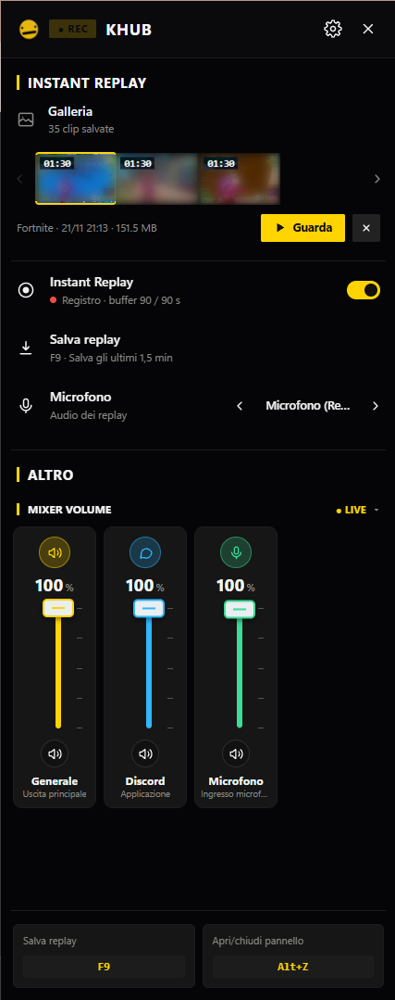

<div align="center">

<!-- 📌 Metti il tuo logo in assets/logo.png (consigliato: 200x200, sfondo trasparente) -->


# Khub

### Tutti i tuoi giochi. Un unico launcher.

Libreria, statistiche, instant replay e controller in un'app veloce, elegante e **100% locale**.

<br/>

[](https://github.com/K3KK09/Khub/releases)
[](#-installazione)
[](https://www.python.org/downloads/)
[](https://github.com/K3KK09/Khub/stargazers)

[**Scarica**](https://github.com/K3KK09/Khub/releases) · [**Funzioni**](#-funzioni) · [**Installazione**](#-installazione) · [**FAQ**](#-domande-frequenti)

<br/>

<!-- 📸 Screenshot principale: assets/screenshots/hero.png (consigliato: 1600x900) -->


</div>

<br/>

## ✦ Cos'è Khub

**Khub** è un launcher personale per videogiochi. Invece di aprire Steam, Epic Games e decine di collegamenti diversi, apri Khub e trovi **tutto in un posto solo**: scegli un gioco, lo avvii, e Khub tiene il conto di quanto giochi.

Pensato per chi ha tanti giochi su piattaforme diverse e vuole **ordine, statistiche e un po' di divertimento in più**.

|  |  |  |
|:--:|:--:|:--:|
| 📚 **Una libreria** <br/> Steam, Epic, Xbox, Ubisoft e `.exe` | 📊 **Statistiche** <br/> Ore giocate, grafici e Wrapped | 🎬 **Instant Replay** <br/> Salva gli ultimi secondi di gioco |

<br/>

## ✦ Funzioni

### 📚 Libreria intelligente

Tutti i tuoi giochi, da ogni piattaforma, con copertine, ricerca istantanea, filtri per genere / piattaforma / stato / voto, e vista a griglia o a lista. La **sincronizzazione** trova da sola i giochi installati.

<div align="center">

</div>

<br/>

### 📊 Statistiche e Wrapped

Scopri quanto giochi davvero: grafici per giorno, settimana e mese, gioco del mese e dell'anno, confronto tra periodi e backlog. A fine anno ottieni il tuo **Gaming Wrapped**, in stile Spotify, da salvare e condividere.

<div align="center">
<table>
<tr>
<td width="50%"></td>
<td width="50%"></td>
</tr>
<tr>
<td align="center"><sub>Statistiche avanzate</sub></td>
<td align="center"><sub>Gaming Wrapped</sub></td>
</tr>
</table>
</div>

<br/>

### 🎬 Instant Replay

Con un solo tasto salvi **gli ultimi secondi di gioco**, come un replay istantaneo. Include mixer audio con riduzione del rumore del microfono e un lettore video integrato per rivedere le clip.

<div align="center">
<table>
<tr>
<td width="50%"></td>
<td width="50%"></td>
</tr>
<tr>
<td align="center"><sub>Pannello Instant Replay</sub></td>
<td align="center"><sub>Lettore video</sub></td>
</tr>
</table>
</div>

<br/>

### 🕹️ Controller e Big Picture

Usa Khub direttamente col **gamepad** (anche PS4 / PS5), comodo dal divano, con una modalità **Big Picture** a schermo intero pensata per il controller.

<div align="center">

</div>

<br/>

### ⚡ E non solo

<table>
<tr>
<td width="33%" valign="top">

**🎁 Profilo e livelli**
Guadagna XP giocando, sali di livello e sblocca colori, sfondi e il regalo giornaliero.

</td>
<td width="33%" valign="top">

**🎲 Consigli e casuale**
Non sai cosa giocare? Ricevi un suggerimento in base ai tuoi gusti, o lascia scegliere al caso.

</td>
<td width="33%" valign="top">

**🔊 Soundboard**
Fai partire suoni con una combinazione di tasti, ideale anche per le clip.

</td>
</tr>
<tr>
<td width="33%" valign="top">

**💬 Discord**
Mostra sul tuo profilo che stai usando Khub o a cosa stai giocando.

</td>
<td width="33%" valign="top">

**🆓 Giochi gratis**
Vedi i giochi gratuiti del momento su Epic Games.

</td>
<td width="33%" valign="top">

**🎨 Personalizzazione**
Colori, sfondi, temi e lingua (🇮🇹 Italiano / 🇬🇧 English).

</td>
</tr>
</table>

> 🔒 **Privacy:** i tuoi dati restano sul tuo PC. Khub non invia nulla online.

<br/>

## ✦ Installazione

### Requisiti

- **Windows 10 / 11** (alcune funzioni, come l'Instant Replay, funzionano solo su Windows)
- **Python 3.9+** → [python.org](https://www.python.org/downloads/)

### Avvio rapido

**1.** Scarica il repository (**Code → Download ZIP**) e scompattalo.

**2.** Installa la libreria principale:

```bash
pip install pywebview
```

**3.** Avvia Khub con doppio clic su `Khub.pyw`, oppure:

```bash
python Khub.pyw
```

> Alla prima apertura parte un **tutorial guidato** che ti mostra tutte le funzioni. 👋

<details>
<summary><b>➕ Librerie opzionali (funzioni extra)</b></summary>

<br/>

```bash
pip install pillow pystray pypresence psutil hidapi
```

| Libreria | Serve per |
|---|---|
| `pillow` | Copertine dei giochi |
| `pystray` | Ridurre Khub nella barra delle applicazioni |
| `pypresence` | Mostrare l'attività su Discord |
| `psutil` | Riconoscere i giochi in esecuzione |
| `hidapi` | LED del controller PlayStation |

> Dalle **Impostazioni → Componenti** Khub rileva le librerie mancanti e le installa con un clic.

</details>

<details>
<summary><b>📦 Creare l'eseguibile .exe</b></summary>

<br/>

```bash
pip install pyinstaller
pyinstaller --noconsole --onefile --add-data "index.html;." --add-data "panel.html;." --add-data "player.html;." Khub.pyw
```

L'eseguibile viene creato nella cartella `dist`.

</details>

<br/>

## ✦ Struttura del progetto

```text
Khub/
├── Khub.pyw        # Avvio del programma (include il motore di Khub)
├── index.html      # Interfaccia principale
├── panel.html      # Pannello Instant Replay
├── player.html     # Lettore video dei replay
└── assets/         # Logo e screenshot per questo README
```

> ⚠️ Tieni `Khub.pyw`, `index.html`, `panel.html` e `player.html` **nella stessa cartella**.

I dati (libreria, statistiche, impostazioni) sono salvati in una cartella fissa sul tuo PC, nel file `game_hub_data.json`: non perdi nulla anche se sposti o aggiorni il programma.

<br/>

## ✦ Domande frequenti

<details>
<summary><b>Il programma non si apre</b></summary>
<br/>
Controlla di aver installato <code>pywebview</code> e che i quattro file siano nella stessa cartella.
</details>

<details>
<summary><b>L'Instant Replay non funziona</b></summary>
<br/>
Serve <b>ffmpeg</b>: Khub ti guida nell'installazione dalle Impostazioni.
</details>

<details>
<summary><b>Su Discord non compare nulla</b></summary>
<br/>
Attiva «Condividi la mia attività» nelle impostazioni di Discord e in Khub.
</details>

<details>
<summary><b>Come si aggiorna?</b></summary>
<br/>
Khub controlla da solo se è disponibile una nuova versione su GitHub e può aggiornarsi.
</details>

<br/>

## ✦ Contribuire

Hai un'idea o hai trovato un bug? Apri una [**Issue**](https://github.com/K3KK09/Khub/issues) o una **Pull Request**: ogni aiuto è benvenuto.

## ✦ Licenza

Distribuito con licenza **MIT**. <!-- ⚠️ Cambia se preferisci un'altra licenza e aggiungi il file LICENSE -->

<br/>

<div align="center">

**Fatto con ❤️ da [K3KK09](https://github.com/K3KK09)**

Se Khub ti piace, lascia una ⭐ al progetto!

</div>
